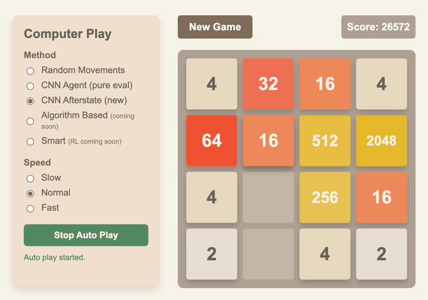
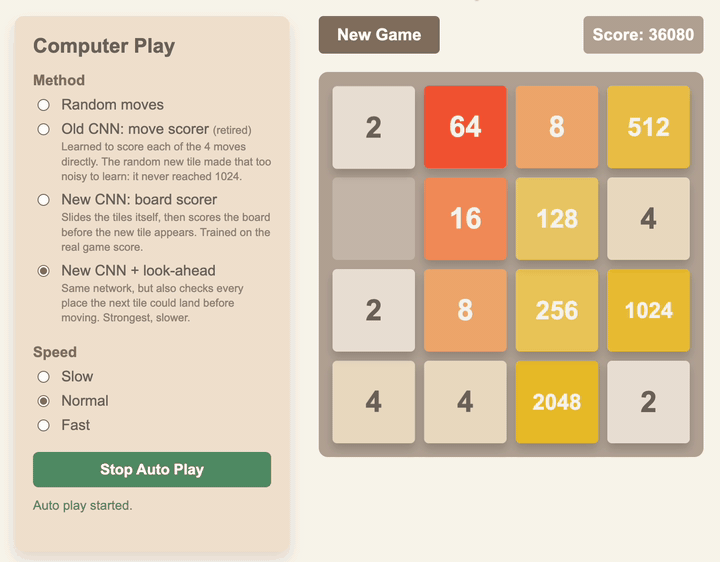
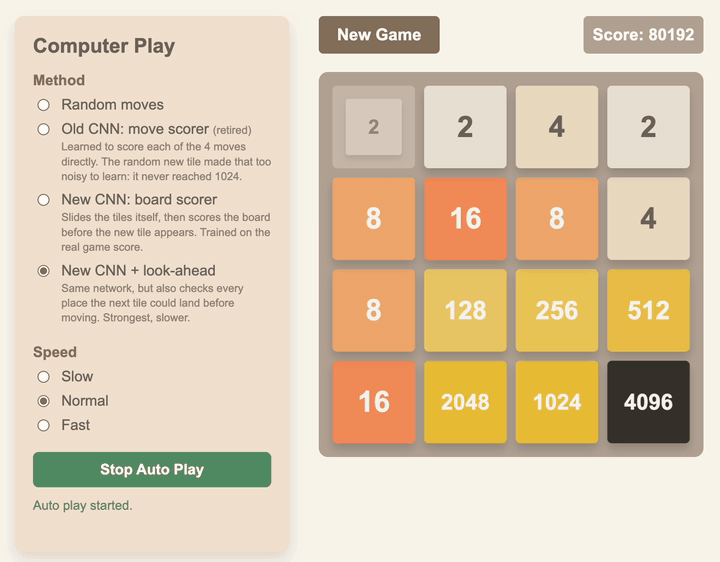
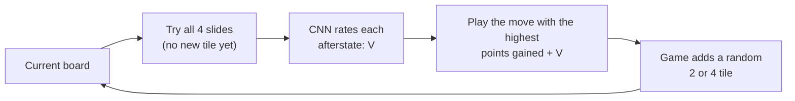
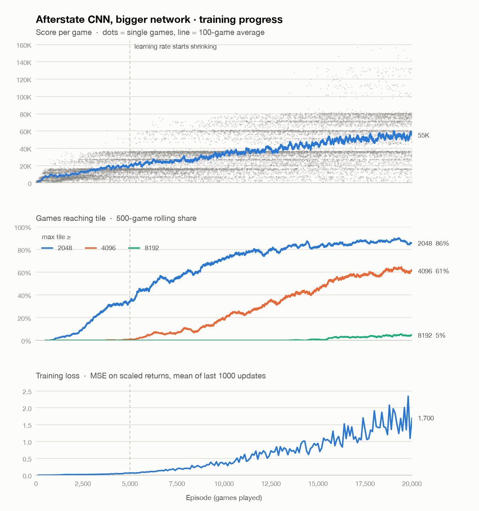
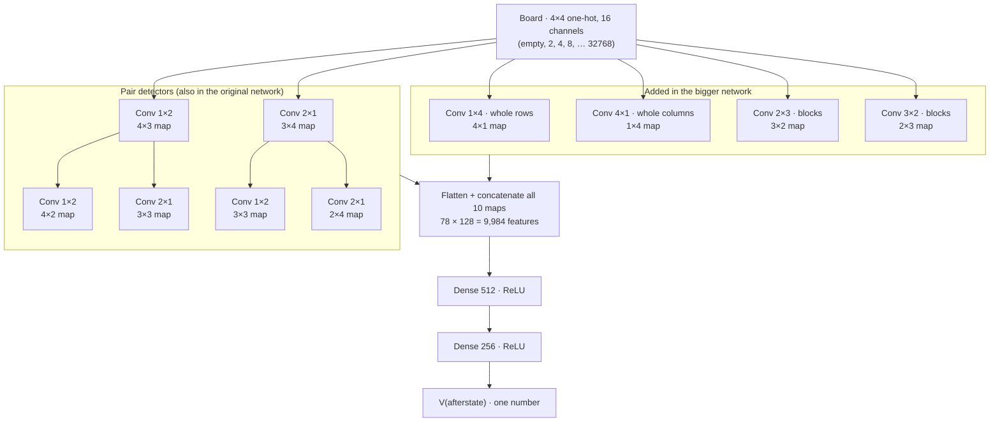

# 2048-Auto

<h2 align="center"><a href="https://mr-neptune.github.io/2048-Auto/">▶ Watch the agent play in your browser</a></h2>
<p align="center">Pick a method and a speed. Nothing to install.</p>

2048 is a well known puzzle game, where the player will move number tiles in a 4×4 grid to merge the number 2048, or even higher.

The game logic is implemented in Python 3, and the user interface is implemented in HTML, CSS, and JavaScript. A small Flask server (`app.py`) exposes HTTP endpoints so the same environment can drive both the browser UI and automated agents.

## Demo

How far the agent has come, in order. Each clip is the end of a game auto-played in the browser UI.

**1 · Reaching 2048.** An early version: the original network after 3,000 training episodes, no look-ahead. It builds a 2048 tile and the game ends at 26,964 points.

<p align="center">
  
</p>

**2 · Reaching 4096.** The current player: the bigger network after 20,000 training episodes, with look-ahead. It merges a chain of 2048, 1024, 512, 256 and 128 into a 4096 tile, and the game continues.

<p align="center">
  
</p>

**3 · Almost 8192.** The same player. The game ends at 80,576 points with every tile from 8 up to 4096 on the board. Together they add up to just over 8192, but they aren't lined up to merge and the board fills up.

<p align="center">
  
</p>

To watch it yourself, open the **[web page](https://mr-neptune.github.io/2048-Auto/)**, pick **New CNN + look-ahead** and press **Start Auto Play**. **New CNN: board scorer** plays the same network without look-ahead, and **Old CNN: move scorer** is the retired DQN, kept for comparison.

To run the app on your own machine, follow [Getting started](#getting-started) and open http://localhost:5001. The app loads `bin/cnn_after_v2lr20_ep20000.chkpt`, the bigger network after 20,000 training episodes; set `AFTERSTATE_CKPT_PATH` to use another checkpoint.

## CNN afterstate agent

`CNN/cnn_afterstate.py` is the current best agent. It replaced the earlier DQN (`CNN/cnn_agent.py`), which stalled at about 2.5K points after 20K episodes. [docs/training.md](docs/training.md) explains every part of training step by step, with diagrams.

**The idea.** A 2048 move has two parts: your slide, which is fully predictable, and a random new tile, which is luck. The DQN had to guess both at once. The afterstate agent slides the tiles itself (the rules are known), so it only asks the network one question: *how good is this board right after my slide, before the new tile appears?* That board is the **afterstate**.



Training details:

- **Reward is the real game score.** There are no hand-made bonus rewards.
- **TD(λ) targets.** After each game, every afterstate is trained toward a mix of the points actually earned afterwards and the network's own estimate of later boards (λ = 0.5, no discount).
- **8× data.** A board is equally good rotated or mirrored, so each training sample gets one of the 8 symmetries at random.
- **No random exploration.** The random tile spawns already make every game different.
- **Replay buffer** of 50K afterstates. Each afterstate is trained on about 8 times.
- **Shrinking learning rate.** 1e-4 for the first 5,000 episodes, then a cosine curve down to 1e-5 at episode 20,000.

### Results

Every result below comes from the same 500 test games: each checkpoint gets the same sequence of random tiles (seed 42). "Reached" means the game's largest tile was at least that tile. **Look-ahead** means the player checks every new tile that could appear before it picks a move (2-ply expectimax). **Greedy** means it plays the network's top-rated move directly.

**The best player** is the bigger network after 20,000 training episodes, with look-ahead:

| Reached tile | Bigger network + look-ahead<br/>10K episodes | **Bigger network + look-ahead**<br/>**20K episodes** |
|---|---|---|
| 2048 | 97.0% | **98.8%** |
| 4096 | 76.2% | **94.8%** |
| 8192 | 1.0% | **52.0%** |
| 16384 | 0% | 0% |
| Average score | 63.8K | **111.0K** |
| Best score | 112.8K | **175.6K** |

With the same look-ahead, training from 10K to 20K episodes took 8192 from 1 game in 100 to about half of all games (52.0% ± 4.4).

**The network alone (greedy):**

| Reached tile | Old DQN<br/>20K episodes | Original network<br/>10K episodes | Bigger network<br/>10K episodes | Bigger network<br/>training games 19K–20K* |
|---|---|---|---|---|
| 2048 | 0% | 71.2% | 79.2% | 86.7% |
| 4096 | 0% | 12.6% | 27.6% | 61.8% |
| 8192 | 0% | 0% | 0% | 4.6% |
| Average score | 2.5K | 30.5K | 36.9K | 54.1K |
| Best score | – | 74.9K | 76.5K | 156.4K |

\*The last 1,000 training games. They are played greedily too, but not on the shared test tiles. The old DQN was tested on 200 games.

**Where it stops.** No game has reached 16384 yet. A 16384 tile is worth about 210K points. The best test games ended at 173–176K, holding roughly 8192, 4096, 2048, 1024 and 512, and needed one more 512 to merge all the way up. Two things hold it back:

- **The look-ahead is short.** It sees two of the player's moves.
- **The network has barely trained on these boards.** No training game ever scored above 156K, but 120 of the 260 test games that reached 8192 ended above that.

The likely next steps are a deeper look-ahead on crowded boards and more late-game training data.

### Training progress

<picture>
  <source media="(prefers-color-scheme: dark)" srcset="docs/images/training_progress_dark.png">
  
</picture>

- **Score.** Each dot is one training game and the line is the 100-game average. The average rises from about 20K at episode 5,000 to about 55K at 20,000. The horizontal bands are games that ended holding the same big tiles. For example, about 36K means a 2048 with a 1024, 512 and 256 beside it, and about 80K is the same chain one tile higher. Every dot above 90K is a game that reached 8192.
- **Tile rates.** These show the share of the last 500 games that reached 2048, 4096 and 8192. They climb fastest between 10K and 17K, as the learning rate shrinks. They level off after 18K, when the rate is close to its floor of 1e-5.
- **Loss going up is expected here.** The network predicts the points still to come, and those values grow as the agent survives longer (a 4096 game is worth roughly 2× a 2048 game). Bigger targets mean bigger squared errors, even when the relative error is flat.

Regenerate the charts with `python -m CNN.plot_training` (needs `matplotlib`).

### Network architecture

The bigger network (`--arch v2`) gives all the current results:



- **Input.** Each cell becomes 16 on/off channels: channel 0 means empty and channel *k* means tile 2^k. This way the network sees "a 512 next to a 512" as a pattern, not as a large number.
- **Pair detectors.** Every convolution has 128 filters and a ReLU. 1×2 kernels look at horizontal neighbor pairs and 2×1 kernels look at vertical pairs. Those are exactly the pairs that can merge on a left/right or up/down slide. Stacking two layers covers rows and columns of 3, and the cross branches (1×2 then 2×1, and the reverse) cover 2×2 squares.
- **Wider detectors.** Whole-row and whole-column kernels see a full edge at once, and 2×3 / 3×2 kernels see blocks of six cells. They help the network judge chains like 1024-512-256-128 along an edge.
- **Head.** All ten feature maps are flattened, concatenated and passed through two hidden layers to a single value. That value is the predicted future score (scaled by 1/1000) of the afterstate.
- **Size.** 5.43M parameters: 5.11M in the first dense layer and 182K in the convolutions. The original network (`--arch v1`, 2.04M parameters) has only the six pair maps and a single Dense 256 layer. It's the same trunk the old DQN used.

### Train, resume, evaluate

```bash
# train the bigger network for 20,000 episodes; the learning rate shrinks from 1e-4 to 1e-5
# between episodes 5,000 and 20,000 (CPU is ~2x faster than the Metal GPU on Apple silicon;
# wrap in caffeinate so the Mac stays awake)
caffeinate -i python -m CNN.cnn_afterstate --arch v2 --episodes 20000 --resume \
  --lr-schedule cosine --lr-decay-start 5000 --lr-decay-end 20000 \
  --save-path bin/cnn_after_v2lr20.chkpt --metrics-path CNN/logs/cnn_after_v2lr20_train.csv \
  --log-interval 100 --checkpoint-interval 200 --snapshot-interval 1000 >> CNN/logs/cnn_after_v2lr20.out 2>&1

# test a checkpoint with 500 greedy games (prints the tile table)
python -m CNN.cnn_afterstate --eval-only --resume --arch v2 --save-path bin/cnn_after_v2lr20_ep20000.chkpt \
  --eval-episodes 500 --eval-metrics-path CNN/logs/eval_v2lr20_ep20000.csv

# same, but every move uses 2-ply look-ahead (about 8x slower per move)
python -m CNN.cnn_afterstate --eval-only --resume --arch v2 --save-path bin/cnn_after_v2lr20_ep20000.chkpt \
  --eval-episodes 500 --eval-metrics-path CNN/logs/eval_search_v2lr20_ep20000.csv --search-depth 2
```

- **Resuming training.** `--resume` continues from the last checkpoint: weights, optimizer state, replay buffer and episode counter. Checkpoints are written atomically every `--checkpoint-interval` episodes, so an interrupted run loses at most that many episodes.
- **Training in chunks.** `--episodes` sets where a run stops and `--lr-decay-end` sets where the learning-rate curve ends. A long run can be split into chunks (we stopped at 10K, 13K, 16K and 18K) and still follow one curve.
- **Resuming tests.** With `--resume` and the same `--eval-metrics-path`, a stopped test continues with the next game. It plays exactly the games an uninterrupted test would.
- **Sharing the computer.** `--threads 5` leaves CPU cores free for other apps. `caffeinate` can't keep the Mac awake with the lid closed; training just pauses until it wakes.
- **Time.** On an M2 Pro CPU, the 20,000 episodes took about 25 hours. A 500-game look-ahead test of the 20K network takes about 5 hours.

### Experiments: one change at a time

Each experiment changes exactly one thing and is judged on the same 500 greedy test games (same random seed).

| Experiment | Compared with | Reached 2048 | Reached 4096 | Avg score |
|---|---|---|---|---|
| Baseline, 7K episodes | – | 35.4% | 1.4% | 18.5K |
| Shrinking learning rate (episodes 5K→7K) | baseline at 7K | **58.4%** | **12.6%** | 27.0K |
| Bigger network (`--arch v2`), 7K episodes | baseline at 7K | **46.4%** | **3.8%** | 21.5K |
| 2-ply look-ahead when playing (same 7K network) | the same network played greedily | **90.2%** | **43.4%** | 45.7K |

The look-ahead row measures a different thing from the others. It doesn't change the network; it spends about 8× more computation per move to think one tile spawn ahead. Its results are always reported separately from greedy play.

**Combining the two training changes.** Both networks get the same recipe here (5K episodes at a constant learning rate, then a shrinking rate from 5K to 7K), so only the network differs:

| 7K episodes, shrinking LR | Reached 2048 | Reached 4096 | Reached 8192 | Avg score | Best score |
|---|---|---|---|---|---|
| Original network, greedy | 58.4% | 12.6% | 0% | 27.0K | 79.5K |
| **Bigger network, greedy** | **69.6%** | **17.2%** | 0% | **31.0K** | 79.6K |
| Original network + look-ahead | 93.6% | 71.4% | 4.0% | 62.1K | **132.3K** |
| **Bigger network + look-ahead** | **96.0%** | **76.0%** | **4.4%** | **65.2K** | 130.6K |

The two training changes stack: the bigger network with a shrinking learning rate beats the original network trained 3K episodes longer (65.8% reached 2048 at 10K). With look-ahead, both players reach 8192 in about 4% of games.

**The long run.** Both networks then continued from their 5K checkpoints with the learning rate set to shrink over 5K→20K, and were tested at 10K, partway down the curve:

| 10K episodes, LR shrinking until 20K | Reached 2048 | Reached 4096 | Reached 8192 | Avg score | Best score |
|---|---|---|---|---|---|
| Original network, greedy | 71.2% | 12.6% | 0% | 30.5K | 74.9K |
| **Bigger network, greedy** | **79.2%** | **27.6%** | 0% | **36.9K** | **76.5K** |
| Original network + look-ahead | 95.8% | 66.4% | 0.2% | 57.6K | 103.7K |
| **Bigger network + look-ahead** | **97.0%** | **76.2%** | **1.0%** | **63.8K** | **112.8K** |

The bigger network won all four tests, so only it continued to 20K. At 10K its 8192 rate was lower than in the 7K run (1.0% against 4.4%), because its learning rate was still high: 7.75e-5, while the 7K run had already reached 1e-5. As the rate came down, the gains arrived, ending at 52.0% at 20K (see [Results](#results)).

## Getting started

```bash
python3 -m venv .venv && source .venv/bin/activate
pip install -r requirements.txt
python -m flask --app app run --port 5001   # browser UI at http://localhost:5001
```

## Repository layout

| Path | What it is |
|---|---|
| `game2048.py` | 2048 game rules, shared by training and the web UI |
| `app.py`, `templates/`, `static/` | Flask server and browser UI, including agent auto-play |
| `CNN/cnn_afterstate.py` | Afterstate value-learning agent (current model): train, resume, evaluate |
| `CNN/afterstate_search.py` | 2-ply look-ahead (expectimax) move choice, used by tests and the UI |
| `CNN/cnn_agent.py` | Earlier DQN agent; also provides the shared convolution blocks |
| `CNN/plot_training.py` | Builds the training-progress charts from the logs |
| `docs/training.md` | How training works, step by step, with diagrams |
| `docs/images/` | Images used in this README |

Checkpoints (`bin/`), training logs (`CNN/logs/`) and the virtual environment (`.venv/`) are kept local and are not committed.

## Branches

| Branch | Used for | What it stores |
|---|---|---|
| `cnn_training` *(default)* | Main line of development | Everything above: game, UI, the afterstate CNN agent, the earlier DQN, plotting, docs |
| `main` | Stable copy of `cnn_training` | Updated from `cnn_training` at milestones |
| `lever_lr_decay` | Experiment (merged into `cnn_training`): a learning rate that shrinks during training | `--lr-schedule cosine` in the afterstate trainer |
| `lever_bigger_net` | Experiment (merged into `cnn_training`): a larger value network | `--arch v2` (whole-row, whole-column and block detectors, deeper head) |
| `lever_search` | Experiment (merged into `cnn_training`): 2-ply look-ahead when playing | `CNN/afterstate_search.py`, `--search-depth 2` for evaluation |
| `postgreDB` | Archive: Postgres metrics logging | `db/`, `docker-compose.yml`, trainers with `--db-url` logging |
| `mlp_training` | Archive: the earlier MLP Q-learning agent | `MLP/` agent, features and its training logs |

Each `lever_*` branch changes exactly one thing compared with `cnn_training`, so its effect on the agent can be measured on its own before it is merged. Branches that have been merged are kept as a record of the experiment.
