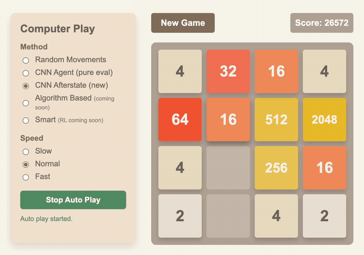
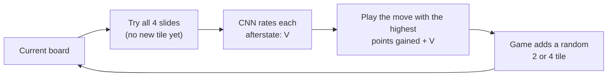
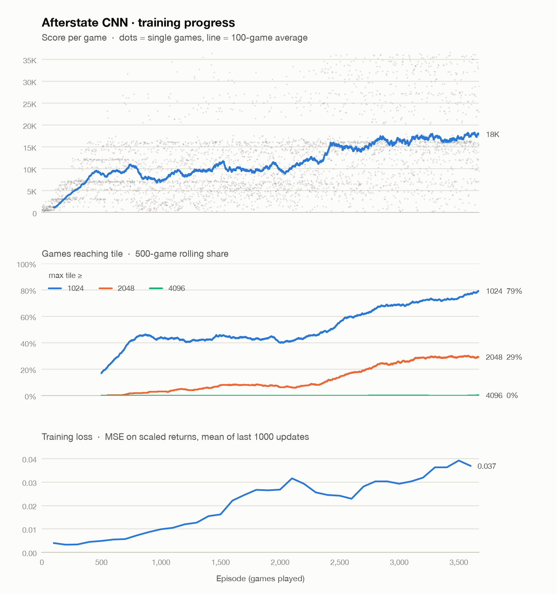
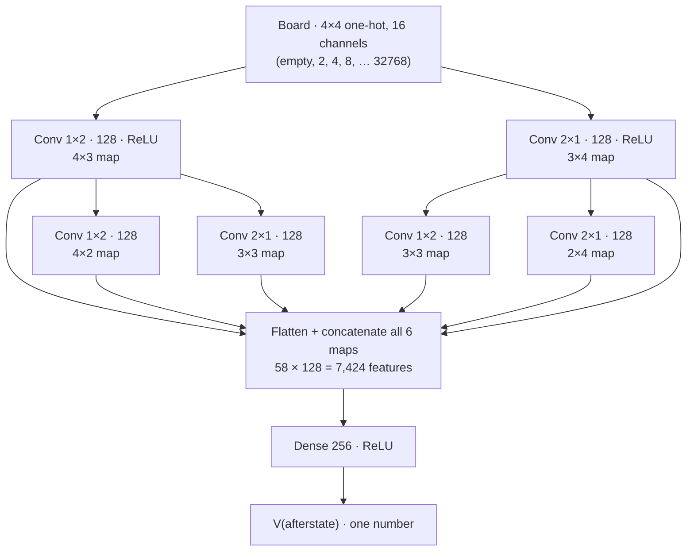

# 2048-Auto

2048 is a well known puzzle game, where the player will move number tiles in a 4×4 grid to merge the number 2048, or even higher.

The game logic is implemented in Python 3, and the user interface is implemented in HTML, CSS, and JavaScript. A small Flask server (`app.py`) exposes HTTP endpoints so the same environment can drive both the browser UI and automated agents.

## Demo

<p align="center">
  
</p>

The final moves of a game played by the afterstate CNN agent (episode-3000 checkpoint, no randomness): it builds a 2048 tile and ends at 26,964 points. To watch it yourself, run `python -m flask --app app run --port 5001`, open http://localhost:5001, pick **CNN Afterstate (new)**, and press **Start Auto Play**.

## CNN afterstate agent

`CNN/cnn_afterstate.py` is the current best agent. It replaced the earlier DQN (`CNN/cnn_agent.py`), which stalled at about 2.5K points after 20K episodes.

**The idea.** A 2048 move has two parts: your slide, which is fully predictable, and a random new tile, which is luck. The DQN had to guess both at once. The afterstate agent slides the tiles itself (the rules are known), so it only asks the network one question: *how good is this board right after my slide, before the new tile appears?* That board is the **afterstate**.



Training details:

- **Reward is the real game score.** There are no hand-made bonus rewards.
- **TD(λ) targets.** After each game, every afterstate is trained toward a mix of the points actually earned afterwards and the network's own estimate of later boards (λ = 0.5, no discount).
- **8× data.** A board is equally good rotated or mirrored, so each training sample gets one of the 8 symmetries at random.
- **No random exploration.** The random tile spawns already make every game different.
- **Replay buffer** of 50K afterstates. Each afterstate is trained on about 8 times.

### Results

Greedy play (always the best move, no random moves). "Reached" means the game's largest tile was at least that tile.

| Reached tile | Old DQN<br/>20K episodes | Afterstate CNN<br/>3K episodes | **Afterstate CNN**<br/>**5K episodes** |
|---|---|---|---|
| 512 | 3.5% | 90% | **92.5%** |
| 1024 | 0% | 70% | **73.5%** |
| 2048 | 0% | 18.5% | **29.5%** |
| 4096 | 0% | 0% | 0% |
| Average score | 2.5K | 14.5K | **16.9K** |
| Best score | – | 36.2K | **36.7K** |
| Games tested | 200 | 200 | 200 |

With a quarter of the old DQN's training episodes, the afterstate agent reaches 2048 in about 30% of games. 4096 has appeared 11 times during training (first at episode 2,744, best score 57K), but not yet in a 200-game test.

### Training progress

<picture>
  <source media="(prefers-color-scheme: dark)" srcset="docs/images/training_progress_dark.png">
  
</picture>

- **Score.** Each dot is one game and the line is the 100-game average. Progress plateaus around episodes 800–2,300, climbs to about 17K by episode 3,500, and then levels off.
- **Tile rates.** These show the share of the last 500 games that reached 1024, 2048 and 4096. Since episode 3,500 they hold at about 80% for 1024 and 30% for 2048.
- **Loss going up is expected here.** The network predicts the points still to come, and those values grow as the agent survives longer (a 2048 game is worth roughly 4× a 512 game). Bigger targets mean bigger squared errors, even when the relative error is flat. The spike near episode 4,800 lines up with a short score dip, and both recovered on their own.

Regenerate the charts with `python -m CNN.plot_training` (needs `matplotlib`).

### Network architecture



- **Input.** Each cell becomes 16 on/off channels: channel 0 means empty and channel *k* means tile 2^k. This way the network sees "a 512 next to a 512" as a pattern, not as a large number.
- **Directional convolutions.** 1×2 kernels look at horizontal neighbor pairs and 2×1 kernels look at vertical pairs. Those are exactly the pairs that can merge on a left/right or up/down slide. Stacking two layers covers rows and columns of 3, and the cross branches (1×2 then 2×1, and the reverse) cover 2×2 squares.
- **Head.** All six feature maps are flattened, concatenated and passed through one hidden layer to a single value. That value is the predicted future score (scaled by 1/1000) of the afterstate.
- **Size.** 2.04M parameters: 1.90M in the first dense layer and 140K in the convolutions. This is the same trunk the old DQN used. Only the output changed, from 4 move values to 1 board value.

### Train, resume, evaluate

```bash
# train (CPU is ~2x faster than the Metal GPU on Apple silicon; wrap in caffeinate so the Mac stays awake)
caffeinate -i python -m CNN.cnn_afterstate --episodes 5000 --resume \
  --save-path bin/cnn_after_pilot.chkpt --metrics-path CNN/logs/cnn_after_pilot_train.csv \
  --log-interval 100 --checkpoint-interval 200 >> CNN/logs/cnn_after_pilot.out 2>&1

# evaluate a checkpoint with 200 greedy games (prints the tile table)
python -m CNN.cnn_afterstate --eval-only --resume --save-path bin/cnn_after_pilot.chkpt --eval-episodes 200
```

`--resume` continues from the last checkpoint: weights, optimizer state, replay buffer and episode counter. Checkpoints are written atomically every `--checkpoint-interval` episodes, so an interrupted run loses at most that many episodes. On an M2 Pro CPU, 3,000 episodes take about 1.2 hours.

Add `--lr-schedule cosine --lr-decay-start <episode>` to shrink the learning rate from `--lr` (1e-4) down to `--lr-min` (1e-5) between that episode and `--episodes`. In our tests this was the biggest training improvement (see below).

### Experiments: one change at a time

Each experiment changes exactly one thing and is judged on the same 500 greedy test games (same random seed).

| Experiment | Compared with | Reached 2048 | Reached 4096 | Avg score |
|---|---|---|---|---|
| Baseline, 7K episodes | – | 35.4% | 1.4% | 18.5K |
| Shrinking learning rate (episodes 5K→7K) | baseline at 7K | **58.4%** | **12.6%** | 27.0K |
| Bigger network (`--arch v2`), 7K episodes | baseline at 7K | **46.4%** | **3.8%** | 21.5K |
| 2-ply look-ahead when playing (same 7K network) | the same network played greedily | **90.2%** | **43.4%** | 45.7K |

The look-ahead row measures a different thing from the others. It doesn't change the network; it spends about 8× more computation per move to think one tile spawn ahead. Its results are always reported separately from greedy play.

## Getting started

```bash
python3 -m venv .venv && source .venv/bin/activate
pip install -r requirements.txt
python -m flask --app app run --port 5001   # browser UI at http://localhost:5001
```

## Repository layout

| Path | What it is |
|---|---|
| `game2048.py` | 2048 game rules, shared by training and the web UI |
| `app.py`, `templates/`, `static/` | Flask server and browser UI, including agent auto-play |
| `CNN/cnn_afterstate.py` | Afterstate value-learning agent (current model): train, resume, evaluate |
| `CNN/cnn_agent.py` | Earlier DQN agent; also provides the shared convolution blocks |
| `CNN/plot_training.py` | Builds the training-progress charts from the logs |
| `docs/images/` | Images used in this README |

Checkpoints (`bin/`), training logs (`CNN/logs/`) and the virtual environment (`.venv/`) are kept local and are not committed.

## Branches

| Branch | Used for | What it stores |
|---|---|---|
| `cnn_training` *(default)* | Main line of development | Everything above: game, UI, the afterstate CNN agent, the earlier DQN, plotting, docs |
| `main` | Stable copy of `cnn_training` | Updated from `cnn_training` at milestones |
| `lever_lr_decay` | Experiment (merged into `cnn_training`): a learning rate that shrinks during training | `--lr-schedule cosine` in the afterstate trainer |
| `lever_bigger_net` | Experiment: a larger value network | `cnn_training` plus `--arch v2` (whole-row, whole-column and block detectors, deeper head) |
| `lever_search` | Experiment: 2-ply look-ahead when playing | `cnn_training` plus `CNN/afterstate_search.py` and `--search-depth 2` for evaluation |
| `postgreDB` | Archive: Postgres metrics logging | `db/`, `docker-compose.yml`, trainers with `--db-url` logging |
| `mlp_training` | Archive: the earlier MLP Q-learning agent | `MLP/` agent, features and its training logs |

Each `lever_*` branch changes exactly one thing compared with `cnn_training`, so its effect on the agent can be measured on its own before it is merged. Branches that have been merged are kept as a record of the experiment.
