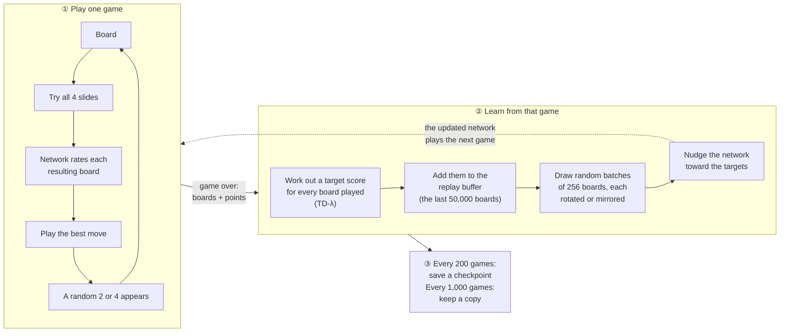
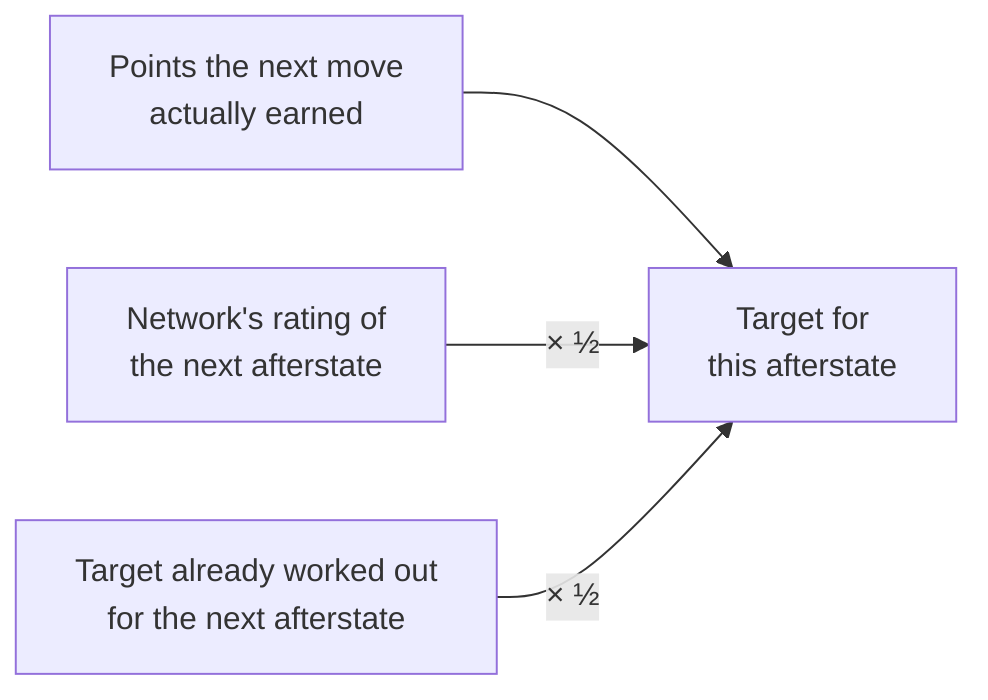
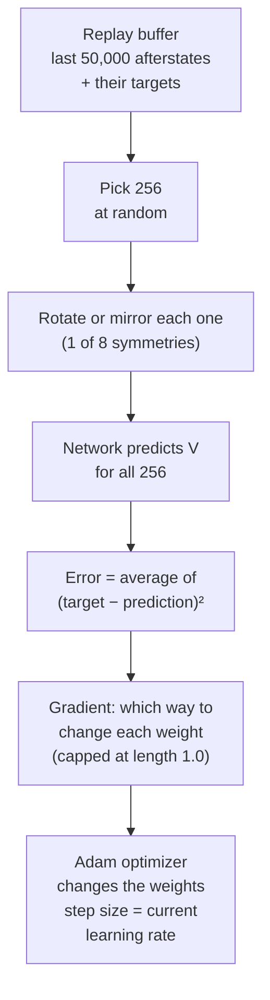
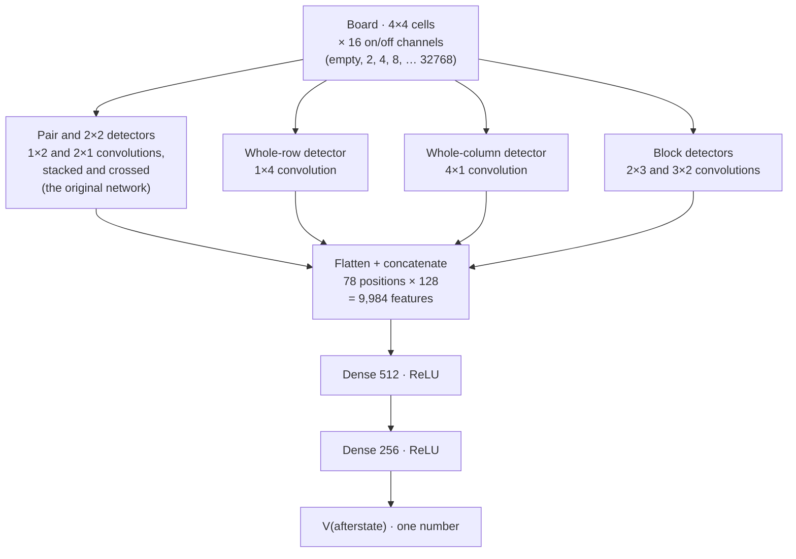
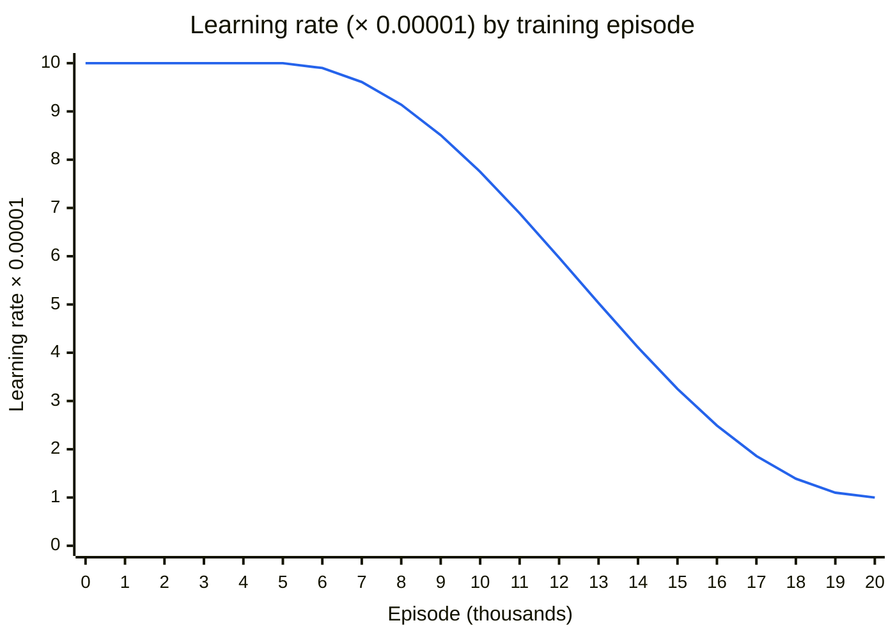
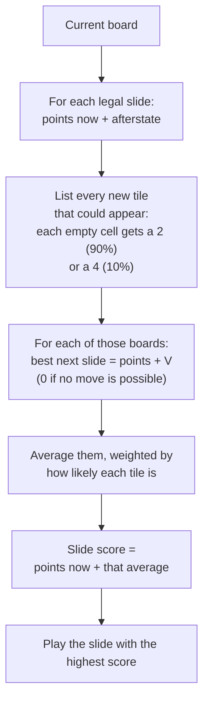
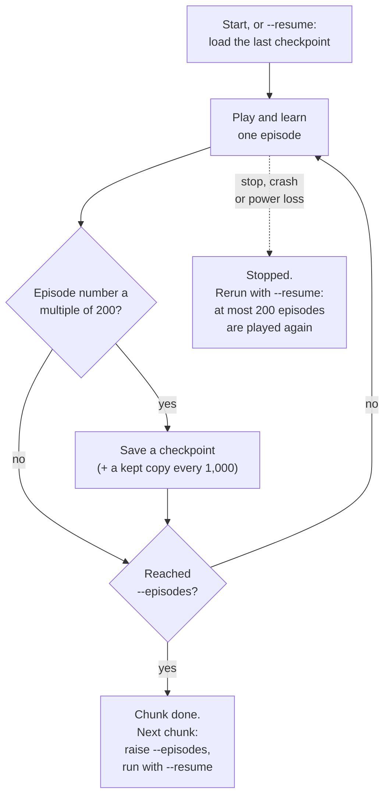
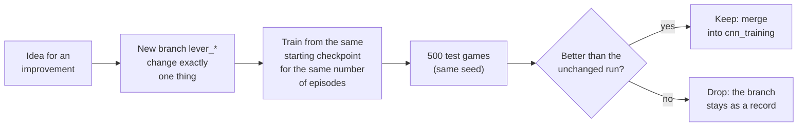
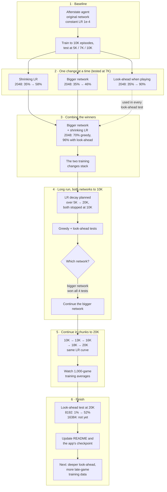

# How training works

This page explains how the afterstate CNN agent learns 2048. It starts with a single move, then covers learning from one game, and ends with the full cycle we used to tune the agent and choose the network. Settings and numbers come from `CNN/cnn_afterstate.py` and from our own test games.

1. [The big picture](#1-the-big-picture)
2. [Words used on this page](#2-words-used-on-this-page)
3. [Choosing a move](#3-choosing-a-move)
4. [Learning from a finished game: TD(λ) targets](#4-learning-from-a-finished-game-tdλ-targets)
5. [Updating the network](#5-updating-the-network)
6. [The network](#6-the-network)
7. [The learning-rate schedule](#7-the-learning-rate-schedule)
8. [Look-ahead: thinking one tile ahead](#8-look-ahead-thinking-one-tile-ahead)
9. [Saving, stopping and resuming](#9-saving-stopping-and-resuming)
10. [How results are measured](#10-how-results-are-measured)
11. [The training and tuning life cycle](#11-the-training-and-tuning-life-cycle)
12. [All settings in one table](#12-all-settings-in-one-table)

## 1. The big picture

Training is a loop. The agent plays a whole game with its current network, learns from that game, and then plays the next game with the slightly better network.

- **One episode** is one full game plus the learning step after it.
- **The network is the only thing that learns.** The game rules and the move search are fixed code.
- **No human strategy is built in.** There's no "keep the big tile in a corner" rule. The agent works out what good boards look like from the game score alone.

## 2. Words used on this page

| Word | Meaning |
|---|---|
| **Afterstate** | The board right after your slide and before the random new tile appears. Your slide is fully predictable; the new tile is luck. |
| **Value, V** | The network's guess of how many more points the game will earn from an afterstate. Stored in thousands of points (a value of 31.2 means about 31,200 more points). |
| **Reward** | The points one move earns from merges (merging two 64s earns 128). |
| **Episode** | One complete game, from the first move until no move is possible. |
| **Target** | The number we want the network to output for a board. Training moves the network's output toward it. |
| **Replay buffer** | A memory of the most recent 50,000 afterstates and their targets. Training samples from it at random, so each lesson isn't only about the latest game. |
| **Learning rate (LR)** | How big each correction to the network is. Big steps learn fast but wobble; small steps settle and fine-tune. |
| **Checkpoint** | A saved copy of everything needed to continue training later. |
| **Greedy play** | Always playing the move the network rates best, with no randomness and no look-ahead. |
| **Look-ahead (expectimax)** | Before moving, considering every new tile that could appear and how good the next move would be after it. |

## 3. Choosing a move

For every legal slide, the agent computes the afterstate itself (the rules are known), asks the network to rate it, and adds the points the slide earns right now:

> **move score = points earned by this slide + V(afterstate)**

It plays the move with the highest score. A small example (values shown in points):

| Move | Points now | Network's V for the afterstate | Move score |
|---|---|---|---|
| Left | 8 | 31,200 | **31,208** ← played |
| Up | 0 | 30,900 | 30,900 |
| Down | 32 | 30,100 | 30,132 |
| Right | – | – | not legal (nothing moves) |

Down earns the most points right now, but it leaves a worse board. The network's rating of the board is what lets the agent play for the long game instead of grabbing points.

There's no random exploration (`--epsilon 0`). The random tile spawns already make every game different, so the agent sees plenty of new boards.

## 4. Learning from a finished game: TD(λ) targets

After a game ends, the agent goes through its afterstates **from last to first** and gives each one a target. Two pieces of information are available for each afterstate:

- **What really happened:** the points the following moves actually earned.
- **What the network expected:** its own rating of the next afterstate.

The target mixes the two:

> **target(t) = points of move t+1 + ½ × V(afterstate t+1) + ½ × target(t+1)**

The last afterstate of the game gets a target of 0, because no more points follow it. Working backwards from there, each target reuses the one after it.

**Why mix?** The mixing weight is λ (lambda), set to 0.5 here.

- **λ = 0, only the network's guess:** each target is stable, but if the network is wrong, the error is copied backwards.
- **λ = 1, only what happened:** the target is honest, but very noisy, because one unlucky tile spawn can ruin a game that was going well.
- **λ = 0.5:** half and half, a common middle ground.

No discount is applied (γ = 1): a point earned 500 moves from now counts the same as a point earned now, because the final score is all that matters.

## 5. Updating the network

The targets from each game go into the replay buffer. Then the network is trained on random batches from that buffer:

- **How many updates per game:** about `moves × 8 ÷ 256`, so every afterstate is trained on about 8 times on average (`--replay-ratio 8`). A 2,000-move game is followed by about 62 updates.
- **Warm-up:** no updates happen until the buffer holds 5,000 afterstates, so the first batches aren't all from one or two games.
- **8 symmetries:** a board rotated or mirrored is exactly as good as the original, so every sample counts as 8 different lessons for free.
- **Gradient cap:** if one batch asks for a huge change, the change is scaled down to length 1.0, which stops rare extreme games from wrecking the network.

## 6. The network

The network takes a board and outputs one number, V. The bigger network (`--arch v2`) is the one we chose for long training:

- **Input:** each cell becomes 16 on/off channels. Channel 0 means empty and channel *k* means tile 2^k, so "a 512 next to a 512" is a pattern rather than a big number.
- **Detectors:** every convolution has 128 filters, each learning one pattern. 1×2 and 2×1 kernels look at the neighbor pairs that can merge. The bigger network adds whole rows, whole columns and 2×3 blocks, which helps it judge chains like 1024-512-256-128 along an edge.
- **Size:** 5.4M weights, against 2.04M for the original network (`--arch v1`), which has only the pair and 2×2 detectors and a single Dense 256 layer. The README's architecture section shows the bigger network layer by layer.

## 7. The learning-rate schedule

The learning rate starts at 1e-4 and stays there for the first 5,000 episodes, so the network learns quickly. From episode 5,000 to 20,000 it shrinks along a cosine curve down to 1e-5, so the network settles into fine adjustments.

- **Formula:** `lr = 1e-5 + ½ × (1e-4 − 1e-5) × (1 + cos(π × progress))`, where progress goes from 0 at episode 5,000 to 1 at episode 20,000.
- **Flags:** `--lr-schedule cosine --lr-decay-start 5000 --lr-decay-end 20000 --lr-min 1e-5`.
- **Training in chunks:** `--episodes` sets where a run stops, while `--lr-decay-end` sets where the curve ends. Stopping at 13K and later continuing to 16K follows exactly the same curve as one long run.
- **What we saw:** the curve is nearly flat at first, so up to 10K it gave only a small gain over a constant rate. The largest gains came at 13K–16K, once the rate had dropped to about half. After 18K, with the rate close to its floor, progress levelled off: 4096 was reached in 61.6% of training games at 18K–19K and 61.8% at 19K–20K.

## 8. Look-ahead: thinking one tile ahead

Look-ahead is used only when **playing** (tests and the browser UI), never for training data. It uses the same trained network but spends more computation on each move.

- **Why it helps:** greedy play rates the board *before* the new tile, so it can't tell when an unlucky spawn would trap it. Look-ahead checks every possible spawn first.
- **Cost:** a board with 8 empty cells has 16 possible spawns. With up to 4 slides each, that's up to 64 boards to rate for every move considered. All of them are rated in one batched network call. Slides are computed with a lookup table covering all 65,536 possible rows. A game takes about 8× longer.
- **Why it's reported separately:** it doesn't change what the network knows, so greedy results measure the network and look-ahead results measure the full player.

## 9. Saving, stopping and resuming

- **What a checkpoint holds:** network weights, the optimizer's internal state, the whole replay buffer, the episode number and the settings. Resuming continues as if nothing happened.
- **Safe saving:** each checkpoint is written to a temporary file first and then renamed in one step. A crash during saving never corrupts the last good checkpoint.
- **Copies:** `--snapshot-interval 1000` also keeps `..._ep11000`, `..._ep12000` and so on, so any milestone can be tested later.
- **What a stop costs:** at most 200 episodes, the ones since the last checkpoint. Those episodes are replayed with different random tiles, because the random generator restarts on resume. The training log is cut back to the checkpoint so no episode is counted twice.
- **Sleep isn't a stop:** if the computer sleeps, training just pauses and carries on when it wakes.
- **Tests can be stopped too:** after each test game, the state of the random generator is saved in a `.progress` file next to the results CSV. Running the same test command with `--resume` continues with the next game and plays exactly the games an uninterrupted test would.
- **CPU cap:** `--threads 5` limits TensorFlow to 5 threads, leaving the computer usable while training runs.

## 10. How results are measured

Training-game numbers are useful for spotting trends, but they're noisy. Decisions are made with a separate test.

- **Test games:** 500 games in a fresh process with random seed 42. Every checkpoint gets the **same sequence of random tile spawns**, so two checkpoints are compared on exactly the same luck.
- **Two kinds of test:** greedy (measures the network) and look-ahead (measures the full player), never mixed in one table.
- **What's recorded:** score, number of moves and largest tile of every game, from which we compute "reached 2048 / 4096 / 8192" rates.
- **Training averages:** a window of 100 training games swings by about ±5 percentage points from luck alone, so trends are read from 1,000-game averages.

## 11. The training and tuning life cycle

### The tuning loop

Every improvement went through the same steps, then the next idea started over. The rule is **change exactly one thing**, so any difference in the results comes from that change.

### What we actually did

- **Stage 2** found the three levers. Look-ahead gave the biggest jump, but it only changes play, so it's reported apart from the two training changes.
- **Stage 3** checked that the two training changes add up instead of overlapping.
- **Stage 4** compared the finalists with a long, fair run. Its 10K tests mostly picked the network; the learning rate was still high at that point, so final quality wasn't judged yet.
- **Stage 5** splits a 10,000-episode run into chunks of a few hours, so the computer can be used, moved or turned off in between without changing the result.
- **Stage 6** tested the finished network: with look-ahead, 8192 rose from 1.0% of test games at 10K to 52.0% at 20K. No game reached 16384. The best games ended at about 176K points, and a 16384 tile is worth about 210K. Those late-game boards are where the network has the least training: no training game scored above 156K.

## 12. All settings in one table

| Setting | Value | Flag | Tuned? |
|---|---|---|---|
| Network | bigger network (5.4M weights) | `--arch v2` | **yes**, against the original (`v1`, 2.04M) |
| Learning rate | 1e-4, cosine down to 1e-5 over episodes 5K→20K | `--lr`, `--lr-schedule`, `--lr-decay-start`, `--lr-decay-end`, `--lr-min` | **yes**, against a constant 1e-4 |
| Move choice in tests | greedy and 2-ply look-ahead | `--search-depth 1` / `2` | **yes** (play only) |
| TD(λ) mix | λ = 0.5 | `--lam` | no |
| Discount | γ = 1 (none) | `--gamma` | no |
| Reward | game score × 0.001 | `--reward-scale` | no |
| Replay buffer | 50,000 afterstates | `--buffer-size` | no |
| Batch size | 256 | `--batch-size` | no |
| Uses per afterstate | about 8 | `--replay-ratio` | no |
| Warm-up | 5,000 afterstates before the first update | `--warmup` | no |
| Optimizer | Adam, gradient length capped at 1.0 | – | no |
| Convolution filters / dense size | 128 / 256 | `--channels`, `--hidden` | no |
| Random moves | none | `--epsilon 0` | no |
| Random seed | 42 | `--seed` | – |
| Checkpoints | every 200 episodes, copies every 1,000 | `--checkpoint-interval`, `--snapshot-interval` | – |
